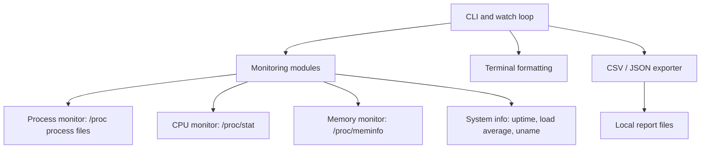

# SysPulse — Linux System Monitor in C++

SysPulse is a lightweight C++17 command-line monitor built around Linux procfs. It reports process, CPU, RAM/swap, uptime, load-average and system information, and exports snapshots to CSV or JSON.

## Features

- Reads `/proc/stat`, `/proc/meminfo`, `/proc/uptime`, `/proc/loadavg`, and `/proc/[pid]/*`.
- Process listing with PID/name/state filters and CPU/memory sorting.
- CPU counters sampled as deltas; per-core utilization is available after a baseline sample.
- RAM utilization uses `MemAvailable`, with a documented fallback.
- CSV and JSON snapshot export, live watch mode, Ctrl+C handling.
- CMake build, automated tests, sanitizer option, local user installation scripts and GitHub Actions CI.

## Requirements

Linux (Ubuntu 22.04/24.04, Debian, or Ubuntu under WSL2), C++17 compiler, CMake 3.16+, and standard Linux procfs. No runtime network access or root privileges are required.

```bash
sudo apt update
sudo apt install -y build-essential cmake
cmake -S . -B build -DCMAKE_BUILD_TYPE=Release
cmake --build build --parallel
ctest --test-dir build --output-on-failure
```

Or run `./scripts/build.sh` and `./scripts/run_tests.sh`.

## Quick start

```bash
./build/syspulse --help
./build/syspulse summary
./build/syspulse cpu
./build/syspulse memory
./build/syspulse processes --sort cpu --limit 20
./build/syspulse processes --sort memory --limit 10
./build/syspulse processes --pid 1
./build/syspulse processes --name bash
./build/syspulse watch --interval 2 --limit 15
./build/syspulse export --format csv --output system_report.csv
./build/syspulse export --format json --output system_report.json
```

`--limit` must be 1–100000; `--interval` is 1–3600 seconds. `--sort` accepts `cpu`, `memory`, or `pid`. `--state` takes a single Linux process-state character. Existing export files are overwritten by design; choose a new output path to preserve a previous report.

## Output and metric definitions

- **System CPU %** is computed from the difference between aggregate `/proc/stat` counters. The first sample is a baseline and reports 0%. Per-core percentages likewise need successive samples.
- **Process CPU %** is based on process user+system tick deltas divided by elapsed seconds and clock ticks per second. It is normalized to one logical CPU; a multithreaded process can exceed 100%.
- **RSS** is resident pages multiplied by the system page size. Virtual memory is read from `vsize` in `/proc/[pid]/stat`.
- **RAM used** is `MemTotal - MemAvailable`. If `MemAvailable` is absent/zero, fallback is `MemFree + Buffers + Cached`, capped at total RAM. This is an estimate; kernel reclaimability and cgroups affect interpretation.
- **Memory units** in the internal/exported memory fields are KiB; process RSS and virtual memory fields are bytes.
- `/proc` values are snapshots and can race with process exits. Permission restrictions may hide command lines or process details.

## Export

CSV contains one row per process, repeating snapshot-wide columns for convenient analysis. JSON has a system object, CPU object, memory object and processes array. These are single snapshots, not time series. For time series, invoke export periodically from a scheduler or use watch for terminal viewing.

## Install locally

```bash
./scripts/install_local.sh
# ensure ~/.local/bin is on PATH
./scripts/uninstall_local.sh
```

## WSL2 setup (Windows)

1. Open PowerShell as Administrator and run `wsl --install -d Ubuntu`.
2. Restart if prompted; launch **Ubuntu** from the Start menu and create a Linux username.
3. In Ubuntu run `sudo apt update && sudo apt install -y build-essential cmake git unzip`.
4. Extract the ZIP inside the Linux home directory for best filesystem performance, e.g. `mkdir -p ~/projects && cd ~/projects && unzip /mnt/c/Users/YOURNAME/Downloads/SysPulse_Linux_System_Monitor_CPP.zip`.
5. `cd SysPulse` (or the extracted folder name), then run the build and test commands above.
6. Run commands from Quick start. Files exported to the current directory can be opened from Windows via `\\wsl.localhost\Ubuntu\home\YOUR_LINUX_USER\projects\SysPulse`.

WSL2 reports the Linux environment visible to that distribution, not all Windows host processes. Container and cgroup limits can also affect the metrics.

## Architecture



The process parser locates the first `(` and final `)` in `/proc/[pid]/stat` so process names containing spaces or parentheses are handled. The fields after the final parenthesis are tokenized, and disappearing or unreadable processes are skipped.

## Tests and diagnostics

```bash
ctest --test-dir build --output-on-failure
cmake -S . -B build-asan -DSYSPULSE_SANITIZERS=ON -DCMAKE_BUILD_TYPE=Debug
cmake --build build-asan --parallel
ctest --test-dir build-asan --output-on-failure
```

Tests cover process stat parsing, malformed input, CSV/JSON escaping, CPU sampling bounds, memory sanity, system info and JSON export. The tests are fixture-like and do not require root. The live integration test checks the current Linux environment.

## Troubleshooting

- **`/proc` missing/restricted:** run inside a normal Linux environment or Ubuntu WSL2; a container may hide host metrics.
- **Permission denied:** some process fields may be unavailable to unprivileged users; SysPulse skips inaccessible records.
- **CMake/compiler missing:** install `build-essential` and `cmake`.
- **CPU initially 0%:** expected for the first sample; run `cpu` again or use `watch`.
- **Watch output not clearing:** ANSI terminal controls are used; non-TTY environments may display escape codes.
- **JSON output path fails:** ensure the parent directory exists and is writable.

## Known limitations and future improvements

- Process username currently reports numeric UID, not name resolution.
- `watch` is a compact terminal redraw, not an ncurses UI.
- The `cpu` one-shot command reports the first sample baseline; use `watch` for changing values.
- Procfs sampling can miss short-lived processes and is subject to permissions and scheduling.
- Future improvements: improved CPU baseline sampling, time-series export, cgroup-aware metrics, optional ncurses UI, and richer integration fixtures.
