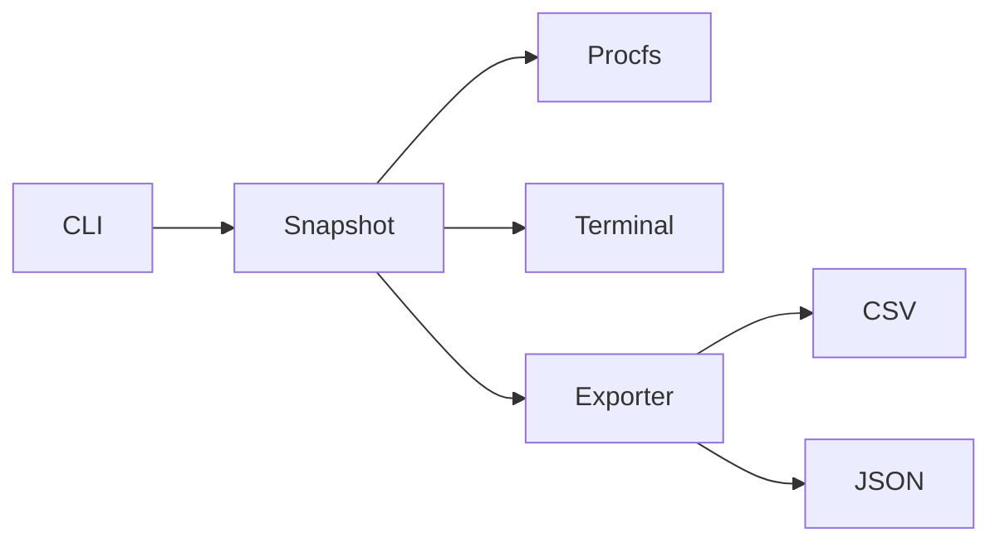

# Architecture

`main.cpp` delegates to `run_cli`. `monitor.cpp` reads Linux procfs and assembles typed snapshots. `exporter.cpp` serializes snapshots without external runtime dependencies. `tests/test_main.cpp` exercises parsers and output helpers.

